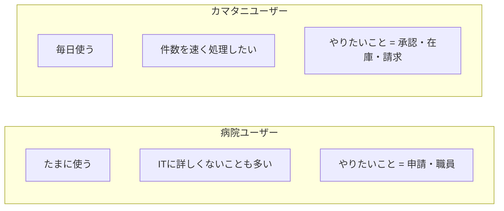
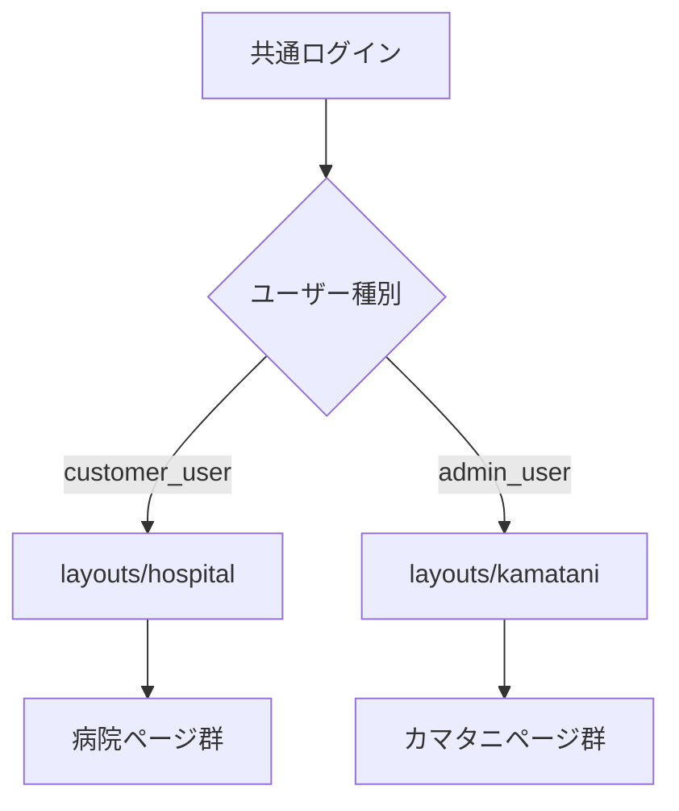
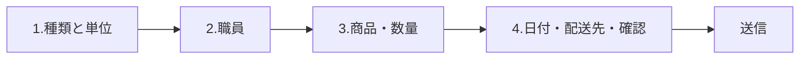

# ユニフォーム管理システム — UI/UX デザイン方針（design.md）

> **目的:** クライアント要望の「シンプル」を満たしつつ、  
> **病院UI** と **カマタニUI** を分けて再設計するための設計書。  
>  
> **業務の正しさ:** `flow.md`（仕様書ベース）に従う。  
> **見た目・画面構成:** 本ドキュメントが正。  
> **現行コードの画面:** 参考にしない（作り直し前提）。

---

## 目次

1. [デザインの結論（先に読む）](#1-デザインの結論先に読む)
2. [なぜ病院とカマタニでUIを分けるか](#2-なぜ病院とカマタニでuiを分けるか)
3. [シンプルの定義（クライアント向け）](#3-シンプルの定義クライアント向け)
4. [デザイン原則](#4-デザイン原則)
5. [ブランド＆ビジュアルシステム](#5-ブランドビジュアルシステム)
6. [全体アーキテクチャ（2シェル）](#6-全体アーキテクチャ2シェル)
7. [病院ポータル設計](#7-病院ポータル設計)
8. [カマタニポータル設計](#8-カマタニポータル設計)
9. [共通画面（ログインなど）](#9-共通画面ログインなど)
10. [コンポーネント規則](#10-コンポーネント規則)
11. [状態・フィードバック・文言](#11-状態フィードバック文言)
12. [レスポンシブ・アクセシビリティ](#12-レスポンシブアクセシビリティ)
13. [ページ一覧（画面インベントリ）](#13-ページ一覧画面インベントリ)
14. [ワイヤーフレーム集](#14-ワイヤーフレーム集)
15. [やってはいけないこと](#15-やってはいけないこと)
16. [実装フェーズ提案](#16-実装フェーズ提案)
17. [flow.md との対応](#17-flowmd-との対応)

---

# 1. デザインの結論（先に読む）

```text
同じブランド（色・フォント・ボタン）
    ├─ 病院シェル … やさしい・少ないメニュー・写真で選ぶ・ウィザード
    └─ カマタニシェル … 作業机・表中心・承認キュー・フィルタ
```

| | 病院 | カマタニ |
|--|------|----------|
| たとえ | 申し込みアプリ | 業務コンソール |
| メニュー数 | 少ない（目安 4〜6） | グループ化して整理 |
| ホーム | 「次にやること」1つ強調 | 「今日の承認待ち」キュー |
| 一覧 | シンプル・大きめ | 高密度テーブル |
| 商品 | **写真カード必須** | サムネ任意・表が主 |
| 密度 | 余白多め | 余白少なめ |

**ログインは2つ。**  
- 病院: `/login`
- カマタニ: `/admin/login`
`/` は `/login` へリダイレクト（選択ページなし）。ログイン後にロールでシェルを切り替える。

---

# 2. なぜ病院とカマタニでUIを分けるか

## 2.1 使う人のちがい



## 2.2 同じUIにすると起きる問題

| 問題 | 結果 |
|------|------|
| メニューが多すぎる | 病院が迷う |
| 写真選びが弱い | 申請ミスが増える |
| 表がゆるい | カマタニの処理が遅い |
| KPIカードだらけ | 「シンプル」に見えない |

## 2.3 分ける範囲

| 共有する | 分ける |
|----------|--------|
| ロゴ・基本色・フォント | レイアウトの密度 |
| ボタン・フォームの形 | サイドメニュー構成 |
| 成功/エラーの出し方 | ホーム画面の目的 |
| ログイン／再発行 | 申請=ウィザード vs 承認=表 |

---

# 3. シンプルの定義（クライアント向け）

「シンプル」＝ 装飾が少ない、という意味だけではない。

| # | 定義 | 具体例 |
|---|------|--------|
| 1 | **1画面1目的** | 申請画面に請求の話を出さない |
| 2 | **次の一手が分かる** | 大きい主ボタンが1つ |
| 3 | **見えない権限は出さない** | 使えないメニューは非表示 |
| 4 | **言葉が短い** | 「申請する」「承認する」 |
| 5 | **選択が少ない** | 病院メニューは必要最小 |
| 6 | **状態が一目** | 色と短いラベル（承認待ちなど） |

クライアント説明用の一文:

> 病院の方には「申し込みしやすい画面」、カマタニには「仕事が速い画面」に分け、見た目のブランドはそろえます。

---

# 4. デザイン原則

## 4.1 共通原則

1. **Brand once, density by role** — 色は共通、情報量は役割で変える  
2. **Progressive disclosure** — 高度な設定は開いてから見せる  
3. **Action > decoration** — グラフやカードは「押せる／判断に使う」ものだけ  
4. **Japanese-first labels** — 画面に仕様番号や英語だらけにしない  
5. **Safe defaults** — サイズ初期値は職員マスタ（仕様どおり）  
6. **Confirm destructive actions** — 削除・却下・ブロックは確認  

## 4.2 病院専用原則

- ウィザード（ステップ）で迷わせない  
- 商品は **必ず画像**  
- エラーは「どうすればよいか」まで書く（やり直す / 特別承認）  
- 契約は「見るだけ」の静かな画面  

## 4.3 カマタニ専用原則

- 一覧で状態・件数・次アクションが見える  
- キーボード／連続処理を意識（承認キュー）  
- フィルタは残すが、初期表示は「今やるべきもの」  
- マスタは表＋右に簡潔フォーム（または別ページ）で十分  

---

# 5. ブランド＆ビジュアルシステム

クライアントはシンプル希望。派手なグラデーションや紫テーマは使わない。

## 5.1 方向性

**「清潔な医療現場 × 作業着レンタル」**  
落ち着いたブルーグリーン系＋グレー。白背景中心。

## 5.2 カラー（提案トークン）

| トークン | 用途 | 提案値 |
|----------|------|--------|
| `--color-brand` | 主ボタン・リンク | `#0F6B6B`（深いティール） |
| `--color-brand-hover` | ホバー | `#0B5555` |
| `--color-bg` | ページ背景 | `#F4F6F7` |
| `--color-surface` | カード/パネル | `#FFFFFF` |
| `--color-border` | 枠線 | `#D8DEE3` |
| `--color-text` | 本文 | `#1A2330` |
| `--color-muted` | 補足 | `#5C6B7A` |
| `--color-success` | 成功・承認済 | `#1B7F4A` |
| `--color-warning` | 待ち・注意 | `#B86E00` |
| `--color-danger` | 却下・エラー | `#C0352B` |
| `--color-info` | 情報 | `#2F5F8A` |

病院シェル: 背景をやや明るく、主ボタン大きめ。  
カマタニシェル: 同じ色、表の行高を詰める。

## 5.3 タイポグラフィ

| 用途 | フォント | サイズ目安 |
|------|----------|------------|
| UI全体 | **Noto Sans JP** | 14px 本文 |
| ページタイトル | Noto Sans JP Medium | 20–24px |
| 補助 | 同 | 12–13px |
| 英数字コード | UI Sans 可 | 表で等幅でも可 |

※ Inter / デフォルトシステムだけ、にはしない。日本語可読性優先。

## 5.4 余白・角・影

| 項目 | 病院 | カマタニ |
|------|------|----------|
| 角丸 | 8–10px | 6–8px |
| 影 | ほぼ無し（枠線のみ） | 無し〜極薄 |
| 余白 | 広め（24–32px） | 標準（16–20px） |
| 表の行 | 余裕 | コンパクト |

**禁止:** 多層シャドウ、グロー、紫グラデ、全面カード祭り。

## 5.5 アイコン

- 線アイコン（Lucide 等）を **メニューと状態だけ** に使う  
- 装飾アイコンの羅列はしない  
- 色だけで状態を伝えない（必ず文字も）  

---

# 6. 全体アーキテクチャ（2シェル）



## 6.1 レイアウト構造

### 病院シェル

```
┌─────────────────────────────────────────────┐
│ Header: ロゴ | 病院名 | ユーザー | 言語 | 出 │
├──────────┬──────────────────────────────────┤
│ Nav      │  Main（広い・余白あり）            │
│ 短いリスト│                                  │
│          │                                  │
└──────────┴──────────────────────────────────┘
```

モバイル: 下タブ or ハンバーガー（主に申請・職員・履歴）。

### カマタニシェル

```
┌─────────────────────────────────────────────┐
│ Header: ロゴ | ロール | 検索(任意) | 出     │
├──────────┬──────────────────────────────────┤
│ Nav      │  Main（表が主）                   │
│ グループ │  ツールバー: フィルタ / 作成      │
│ 化メニュー│                                  │
└──────────┴──────────────────────────────────┘
```

## 6.2 実装ファイル方針（後で）

| ファイル | 役割 |
|----------|------|
| `layouts/guest.blade.php` | ログイン・再発行 |
| `layouts/hospital.blade.php` | 病院シェル |
| `layouts/kamatani.blade.php` | カマタニシェル |
| 共通 partial | ボタン・アラート・ページヘッダ |

ログイン後、`View::share` やミドルウェアでレイアウトを強制。

---

# 7. 病院ポータル設計

## 7.1 情報設計（メニュー）

### 院全体管理者

| メニュー | 目的 |
|----------|------|
| ホーム | 次のアクション案内 |
| 申請 | 作る・一覧・詳細・キャンセル申請 |
| 職員 | 登録・編集・CSV |
| マスタ | 職種 / 配送先 /（運用合意があれば）部署管理者 |
| 契約を見る | 閲覧のみ |
| （設定） | パスワード再発行はログイン画面側が主 |

### 部署管理者

| メニュー | 目的 |
|----------|------|
| ホーム | 自部署向け案内 |
| 申請 | 自部署のみ |
| 職員 | 自部署のみ |

**出さない:** 請求作成、商品在庫編集、カマタニ管理者、ロック解除、契約編集。

## 7.2 ホーム（病院）

目的: **今日何をすればよいか** だけ。

```
┌────────────────────────────────────────────┐
│ こんにちは、○○さん                         │
│                                            │
│  [ 新しい申請を作る ]  ← 主ボタン          │
│                                            │
│  承認待ちの申請     3                      │
│  特別承認のお願い   1                      │
│                                            │
│  最近の申請（最大5件・状態つき）           │
└────────────────────────────────────────────┘
```

KPIの飾りカードは最大3つ。グラフは初期不要。

## 7.3 申請フロー（ウィザード）

仕様どおりの情報を、4ステップに分割。



| Step | 内容 | UI |
|------|------|-----|
| 1 | 新規/返却/交換… ・ 個人/部署一括 | 大きな選択カード |
| 2 | 職員（検索・職員番号） | リスト選択 |
| 3 | 部署・職種で出た商品を写真選択 | **画像グリッド** |
| 4 | 開始日or復職日・配送先・確認 | フォーム＋要約 |

超過時（Step3〜4）:

```
┌─────────────────────────────────────┐
│ 借りられる数を超えています           │
│ ・数量を減らしてやり直す             │
│ ・特別承認を申請する（理由必須）     │
└─────────────────────────────────────┘
```

希望納品日フィールドは **置かない**（仕様）。

## 7.4 職員画面

- 検索: 氏名・職員番号を前面に  
- 一覧はシンプル表（病院でも可）。スマホはカード可  
- 兼職は「追加」アコーディオン（最初から全部開かない）  

## 7.5 契約閲覧

編集コントロールなし。読み取り専用パネル。

```
契約タイプ / 1人あたり上限 / 期間
※ 変更が必要な場合はカマタニへご連絡ください
```

---

# 8. カマタニポータル設計

## 8.1 情報設計（メニューグループ）

```text
ホーム（承認キュー）

申請
  └ 申請一覧

商品・在庫
  ├ ユニフォーム商品
  └ 推奨・指定ユニフォーム

マスタ
  ├ 医療機関
  ├ 部署
  ├ 職種
  └ 配送先

契約・請求
  ├ 契約
  └ 請求データ

管理（システム管理者のみ）
  ├ 管理者ユーザー
  └ アカウントロック

参照
  └ 全職員
```

ロールでグループごと非表示（営業は契約中心、経理は請求中心、運営は申請＋商品）。

## 8.2 ホーム＝承認キュー

カマタニの「シンプル」は **少ない装飾** と **速い処理**。

```
┌──────────────────────────────────────────────────────┐
│ 今日の対応                                            │
│  [通常待ち 12] [特別承認 3] [キャンセル 2]  ←タブ   │
├──────────────────────────────────────────────────────┤
│ フィルタ: 病院 / 種別                                 │
│ ID │ 病院 │ 職員 │ 種別 │ 状態 │ 日時 │ [開く]      │
└──────────────────────────────────────────────────────┘
```

詳細で承認／却下を大きく配置。

## 8.3 一覧画面パターン（共通）

```
[タイトル]                    [主アクション]
[フィルタ行: 必要最小]
[テーブル]
[ページネーション]
```

統計カードは **ホームか一覧上部に最大4つ**。装飾のためだけに置かない。

## 8.4 契約・請求

- 契約: 表＋作成フォーム（権限ある人のみ作成ボタン）  
- 請求: 「基準日 → プレビュー → 生成」の直線フロー  
- 病院向けの写真UIは使わない  

## 8.5 推奨・指定ユニフォーム

カマタニ側は管理画面:

```
病院 → 部署 → 職種 を選ぶ
商品を検索して追加（サムネ＋コード＋名前）
指定 / 推奨 のフラグ
```

病院の申請ウィザードがこのデータを写真付きで消費する。

---

# 9. 共通画面（ログインなど）

## 9.1 ログイン

- 中央カード1枚。背景は薄い単色 or ごく弱いパターン  
- 項目: メール、パスワード、ログイン、パスワードを忘れた  
- 病院/カマタニの切替トグルは **不要**（アカウントで分岐）  

## 9.2 パスワード再発行・再設定

- 手順を上から1・2・3で短く説明  
- 成功メッセージは共通文言（列挙攻撃対策は仕様どおり）  

## 9.3 ロックメッセージ

- 「一時的にロックされています。解除予定: ○月○日 ○○:○○」  
- 病院ユーザーにも分かる日本語  

---

# 10. コンポーネント規則

## 10.1 ボタン

| 種類 | 使い方 |
|------|--------|
| Primary | その画面の主アクション1つ |
| Secondary | 戻る・キャンセル |
| Danger | 却下・削除・ブロック |
| Ghost | 補助 |

病院 Primary: 高さ 44px 以上（押しやすい）。  
カマタニ: 36–40px で密度優先でも可。

## 10.2 フォーム

- ラベルは入力の上  
- 必須は `*` と文言  
- エラーはフィールド直下＋要約はページ上  
- 日付はカレンダー。希望納品日は病院に出さない  

## 10.3 テーブル（カマタニ主）

- 左に主要キー（ID/名前）、右に操作  
- 行ホバーで背景を薄く  
- 操作はアイコン＋テキスト（アイコンのみ禁止）  

## 10.4 カード

- **病院の商品選択** と **ホームの案内** に限定  
- それ以外は表かシンプルブロック  
- 影より枠線  

## 10.5 ステータスチップ

| 状態例 | 色 |
|--------|-----|
| 下書き相当 | グレー |
| 承認待ち | アンバー |
| 特別承認待ち | オレンジ |
| 承認済 | 緑 |
| 却下 | 赤 |
| キャンセル申請 | 青グレー |
| キャンセル済 | グレー |

必ず短い日本語ラベルを併記。

## 10.6 空状態

```
まだ申請がありません
[ 最初の申請を作る ]
```

イラスト過多にしない。短文＋主ボタン。

---

# 11. 状態・フィードバック・文言

## 11.1 トーン

| 場面 | トーン |
|------|--------|
| 病院 | 丁寧・短く・次の行動を示す |
| カマタニ | 簡潔・業務用語OK（ただし専門用語の嵐は避ける） |

## 11.2 例文

| 場面 | 文言例 |
|------|--------|
| 申請送信後 | 申請を受け付けました。カマタニの確認後に結果をお知らせします。 |
| 上限超過 | 契約の貸与上限を超えています。数量を減らすか、特別承認を申請してください。 |
| 承認 | この申請を承認しますか？ |
| 却下 | 却下理由を入力してください。 |
| 納品後キャンセル不可 | 納品が完了しているため、キャンセルできません。 |

## 11.3 トースト / バナー

- 成功: 緑バナー、数秒で消えてよい  
- エラー: 消えない or 明示的に閉じる  
- メール送信失敗などはカマタニにログ＋画面で分かるメッセージ  

---

# 12. レスポンシブ・アクセシビリティ

## 12.1 ブレークポイント目安

| | 病院 | カマタニ |
|--|------|----------|
| モバイル | 申請・確認を優先して最適化 | 閲覧は可、大量承認はデスクトップ推奨と明示してよい |
| タブレット | 2カラム商品グリッド | 表は横スクロール可 |
| デスクトップ | 最大幅 960–1120px で読みやすく | 最大幅 1280–1440px で表を活かす |

## 12.2 a11y 最低ライン

- コントラスト比を満たす  
- フォーカスリングを消さない  
- ボタンに名前（アイコンのみ禁止）  
- 画像には商品名の代替テキスト  

---

# 13. ページ一覧（画面インベントリ）

## 13.1 共通

| ID | 画面 |
|----|------|
| G-01 | ログイン |
| G-02 | パスワード再発行依頼 |
| G-03 | パスワード再設定 |

## 13.2 病院

| ID | 画面 | 院全体 | 部署 |
|----|------|:------:|:----:|
| H-01 | ホーム | ✅ | ✅ |
| H-02 | 申請一覧 | ✅ | ✅（範囲制限） |
| H-03 | 申請作成ウィザード | ✅ | ✅ |
| H-04 | 申請詳細（キャンセル申請） | ✅ | ✅ |
| H-05 | 職員一覧 | ✅ | ✅ |
| H-06 | 職員作成・編集 | ✅ | ✅ |
| H-07 | 職種 | ✅ | ❌ |
| H-08 | 配送先 | ✅ | ❌ |
| H-09 | 契約閲覧 | ✅ | 任意 |
| H-10 | 部署管理者（運用合意時） | ✅ | ❌ |

## 13.3 カマタニ

| ID | 画面 | 主利用者 |
|----|------|----------|
| K-01 | ホーム（承認キュー） | 運営・システム |
| K-02 | 申請一覧・詳細・承認 | 運営・システム |
| K-03 | 商品一覧・作成・編集 | 運営・システム |
| K-04 | 推奨・指定設定 | 運営・システム |
| K-05 | 医療機関 CRUD | システム |
| K-06 | 部署・職種・配送先 | システム |
| K-07 | 契約一覧・作成・編集 | システム（営業は閲覧） |
| K-08 | 請求一覧・作成・詳細 | 経理・システム |
| K-09 | 管理者ユーザー | システム |
| K-10 | アカウントロック | システム |
| K-11 | 全職員参照 | システム等 |

---

# 14. ワイヤーフレーム集

## 14.1 ログイン（共通）

```
┌──────────────────────────────────────┐
│                                      │
│         ユニフォーム管理システム       │
│                                      │
│     ┌──────────────────────────┐     │
│     │ メール                    │     │
│     │ パスワード                │     │
│     │ [ログイン]                │     │
│     │ パスワードを忘れた方     │     │
│     └──────────────────────────┘     │
│                                      │
└──────────────────────────────────────┘
```

## 14.2 病院ホーム

```
┌────────┬─────────────────────────────────────┐
│ ホーム  │ こんにちは、山田さん                 │
│ 申請    │                                     │
│ 職員    │  ┌─────────────────────────────┐   │
│ マスタ  │  │     新しい申請を作る         │   │
│ 契約    │  └─────────────────────────────┘   │
│         │  承認待ち 2   特別承認 1            │
│         │  最近: APP-… 新規 承認待ち          │
└────────┴─────────────────────────────────────┘
```

## 14.3 病院 申請ウィザード Step3（商品）

```
┌─────────────────────────────────────────────┐
│ 手順 1 — 2 — [3 商品] — 4                   │
│ 上着 | ズボン | 靴 | その他                 │
│ ┌──────┐ ┌──────┐ ┌──────┐                 │
│ │写真  │ │写真  │ │写真  │                 │
│ │名称  │ │名称  │ │名称  │                 │
│ │サイズ│ │      │ │      │                 │
│ │数量  │ │      │ │      │                 │
│ └──────┘ └──────┘ └──────┘                 │
│              [戻る]  [次へ]                 │
└─────────────────────────────────────────────┘
```

## 14.4 カマタニ ホーム（キュー）

```
┌────────┬─────────────────────────────────────┐
│ ホーム● │ 対応が必要な申請                     │
│ 申請    │ [通常 12] [特別 3] [キャンセル 2]   │
│ 商品    │ 病院[▼] 種別[▼]  [検索]            │
│ マスタ  │─────────────────────────────────── │
│ 契約請求│ # │病院│職員│種別│状態│   [詳細]  │
│ 管理    │ …                                  │
└────────┴─────────────────────────────────────┘
```

## 14.5 カマタニ 申請詳細

```
┌─────────────────────────────────────────────┐
│ 申請 APP-2026-00123     特別承認待ち         │
│ 病院 / 部署 / 職員 / 開始日 / 配送先         │
│ 明細テーブル（商品・サイズ・数量）           │
│ 申請理由（特別承認）                         │
│                                             │
│ 却下理由 [____________]                     │
│          [却下]              [承認する]     │
└─────────────────────────────────────────────┘
```

## 14.6 カマタニ 請求作成

```
┌─────────────────────────────────────────────┐
│ 請求データを作成                             │
│ 医療機関* [▼]   基準日* [YYYY-MM-DD]         │
│ 契約: 定額 / 単価（自動表示・編集不可）       │
│ [プレビュー]                                 │
│ 対象人数 or ポイント | 予定金額              │
│                     [生成する]               │
└─────────────────────────────────────────────┘
```

---

# 15. やってはいけないこと

| NG | 理由 |
|----|------|
| 病院とカマタニで同じサイドバー | 病院が迷う／カマタニが遅い |
| 紫グラデ・ネオン・過剰アニメ | 「シンプル」に反する |
| ホームにグラフとKPIを大量配置 | 目的がぼける |
| 病院申請に希望納品日 | 仕様違反 |
| 権限のないメニューをグレー表示で残す | ノイズ（隠す） |
| アイコンのみの操作 | 誤操作・a11y |
| 1画面に編集も承認も請求も詰める | 原則違反 |
| マニュアル画面のコピーを仕様扱い | `flow.md` と矛盾しうる |

---

# 16. 実装フェーズ提案

| Phase | 内容 | 成果 |
|-------|------|------|
| **P0** | 2レイアウト骨格＋ログイン共通化＋メニュー分離 | 見た目の土台 |
| **P1** | 病院: ホーム＋申請ウィザード＋申請一覧詳細 | 病院の主価値 |
| **P2** | カマタニ: 承認キュー＋申請詳細承認 | 運営の主価値 |
| **P3** | 職員・マスタを新シェルに載せ替え | 日常運用 |
| **P4** | 契約・請求・推奨指定・管理者 | 管理系 |
| **P5** | 文言統一・余白調整・モバイル病院最適化 | 仕上げ |

既存ロジック（Controller）はできるだけ残し、**View / Layout / CSS** から切り替えるのが安全。

---

# 17. flow.md との対応

| 業務（flow.md） | UIの置き場所 |
|-----------------|--------------|
| ログイン・ロック・再発行 | 共通 guest |
| 病院の申請・職員・配送先追加・契約閲覧 | 病院シェル |
| 承認・特別・キャンセル | カマタニ・申請 |
| 商品・推奨指定 | カマタニ・商品 |
| 契約登録・閲覧（営業） | カマタニ・契約請求 |
| 請求生成 | カマタニ・請求 |
| 管理者・ロック解除 | カマタニ・管理 |

業務要件を変えるデザインはしない。  
分けるのは **見せ方と操作のしやすさだけ**。

---

## 付録 A. クライアント向け1枚サマリ

```text
【デザイン方針】
・病院向け画面とカマタニ向け画面を分けます
・見た目の色やボタンはそろえ、中身の密度を変えます
・病院: 迷わない・写真で選ぶ・ボタン大きめ
・カマタニ: 承認を速く・表で一覧・メニューをグループ分け
・余計なグラフや装飾は置きません
・支払い画面は作りません（仕様どおり請求データまで）
```

## 付録 B. デザイン確認チェックリスト

- [ ] 病院メニューは6個以下が基本か  
- [ ] 申請はウィザードか  
- [ ] 商品に写真があるか  
- [ ] カマタニホームが承認キューか  
- [ ] 営業に契約「作成」が出ていないか（仕様は閲覧）  
- [ ] 病院に請求作成が出ていないか  
- [ ] 希望納品日が無いか  
- [ ] Primary ボタンが画面に実質1つか  
- [ ] 色だけで状態を伝えていないか  

---

*Related: `flow.md`（要件・業務フロー）*  
*This doc: UI/UX redesign for dual portal, simple client-facing design.*

---

## 付録 C. ブランドアセット（Phase 0 済）

マスター（手置き）: `public/images/brand/logo.png`, `favicon.png`  

生成物・チェックリスト: `public/images/brand/README.md`

| ファイル | 用途 |
|----------|------|
| `logo.png` | マスターロゴ |
| `favicon.png` | マスター favicon 原画 |
| `logo-mark.svg` / `logo-mark-64.png` | サイドバー等 |
| `favicon-32.png` / `public/favicon.ico` | ブラウザタブ |
| `brand-tokens.css` | `#0F6B6B` / `#5C6B7A` |
