# ユニフォーム管理システム — 要件定義＆全フロー解説

> **この文書の正しさの根拠**  
> `uniform requirements/ユニフォーム管理システム 仕様書 (1) (1).docx` のみ  
>  
> 操作マニュアル / Uniform Guide / 今のプログラムは **参考にしない**  
> （今の画面説明であり、仕様と違う部分があるため）

> **読み方**  
> - 初めての人は **第1章 → 第3章（全体の流れ）** から読む  
> - ✅ = 仕様に書いてあること  
> - ⚠ = 仕様に書いていない（あとで決める必要あり）  
> - 💡 = 分かりやすくするための設計の提案（仕様と矛盾しない範囲）

---

## 目次

1. [このシステムは何をするか](#1-このシステムは何をするか)
2. [登場人物（だれが使うか）](#2-登場人物だれが使うか)
3. [最初から最後までの全体像](#3-最初から最後までの全体像)
4. [ログイン・パスワード・ロック](#4-ログインパスワードロック)
5. [アカウントをどう作るか](#5-アカウントをどう作るか)
6. [マスタをどう用意するか](#6-マスタをどう用意するか)
7. [契約とは何か・どう作るか・どう効くか](#7-契約とは何かどう作るかどう効くか)
8. [商品と「推奨・指定ユニフォーム」](#8-商品と推奨指定ユニフォーム)
9. [職員の登録・兼職](#9-職員の登録兼職)
10. [ユニフォーム申請（病院）](#10-ユニフォーム申請病院)
11. [承認・在庫（カマタニ）](#11-承認在庫カマタニ)
12. [請求データ（お金の計算。支払いではない）](#12-請求データお金の計算支払いではない)
13. [メール通知](#13-メール通知)
14. [画面イメージ（ワイヤー）まとめ](#14-画面イメージワイヤーまとめ)
15. [要件チェックリスト（全部）](#15-要件チェックリスト全部)
16. [仕様に無いこと・あとで決めること](#16-仕様に無いことあとで決めること)

---

# 1. このシステムは何をするか

## 1.1 一言で言うと

**病院の職員ユニフォームの「借りる・返す・替える」をネットで申請し、カマタニが承認・在庫・請求までまとめて管理する仕組み**です。

## 1.2 やること / やらないこと

| やること ✅ | やらないこと（仕様に無い） |
|-------------|----------------------------|
| 職員の管理 | クレジットカード等の **オンライン支払い** |
| ユニフォーム申請（新規・返却・交換など） | 病院が **希望納品日** を指定すること |
| カマタニによる承認・却下 | クリーニングの申請（※回収だけ。申請不要） |
| 在庫の管理 | 申請の **即削除**（キャンセル申請が必要） |
| 請求データの作成（金額の根拠） | 入金の消込・会計ソフトそのもの |

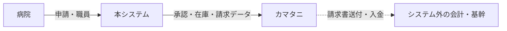

---

# 2. 登場人物（だれが使うか）

システムには **2つの世界** があります。

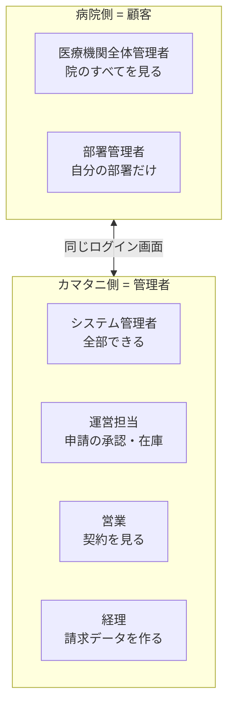

## 2.1 病院側の権限（かんたん表）

| できること | 院の全体管理者 | 部署管理者 |
|------------|:--------------:|:----------:|
| 全部署の職員を追加・編集・休職・退職・復職 | ✅ | ❌ |
| 自分の部署の職員だけ操作 | ✅ | ✅ |
| 職員を CSV で一括（全体） | ✅ | ❌※ |
| 職種の管理・割当 | ✅ | ❌ |
| 全部署のユニフォーム申請 | ✅ | ❌ |
| 自部署の申請 | ✅ | ✅ |
| 配送先を新しく追加 | ✅ | ❌ |
| 契約の内容・上限を **見る** | ✅ | ⚠未記載 |
| 契約を **作る・直す** | ❌ | ❌ |
| 申請履歴を見る | 院内すべて | 自部署のみ |

※部署管理者にも「自部署の一括登録・更新」はある。CSVの細かい範囲は仕様が曖昧 → ⚠

## 2.2 カマタニ側の権限（かんたん表）

| できること | システム | 運営 | 営業 | 経理 |
|------------|:------:|:----:|:----:|:----:|
| 何でもできる・マスタ編集 | ✅ | | | |
| 他のカマタニ管理者アカウントを作る | ✅ | | | |
| 申請を承認／却下（特別・キャンセル含む） | ✅ | ✅ | | |
| 発注・在庫の調整 | ✅ | ✅ | | |
| 契約を **見る** | ✅ | ⚠ | ✅ | ⚠ |
| 契約を **登録する** | ✅※ | ⚠ | ❌※※ | ⚠ |
| 請求データを作る・過去を出す | ✅ | | | ✅ |
| ロックされたアカウントを解除 | ✅ | | | |

※システム管理者は「全機能」なので登録できる  
※※営業は仕様で「閲覧」と書いてある（作る権限は書いていない）

---

# 3. 最初から最後までの全体像

これが **一番大事な図** です。上から下へ、時間が進みます。

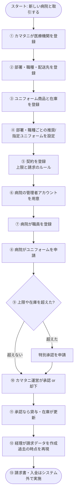

### 初心者向け：各ステップを一言で

| 順番 | だれ | 何をする | なぜ必要 |
|------|------|----------|----------|
| ① | カマタニ | 病院をマスタに入れる | どの病院か識別する |
| ② | カマタニ | 部署・職種・届け先 | 申請の条件になる |
| ③ | カマタニ | 商品と在庫 | 何を貸せるか |
| ④ | カマタニ | 推奨・指定ユニフォーム | 申請画面に写真付きで出す |
| ⑤ | カマタニ | **契約** | 「何着まで」「どう請求するか」 |
| ⑥ | カマタニ等 | 病院のログインを渡す | 病院が入れるようにする |
| ⑦ | 病院 | 職員を登録 | だれに貸すか |
| ⑧ | 病院 | 申請 | 借りたい内容を送る |
| ⑨⑩ | 両方 | 特別承認・通常承認 | ルールを守る／例外を許可 |
| ⑪ | システム | 貸与・在庫 | 実物の管理と連動 |
| ⑫ | 経理 | 請求データ | 金額の根拠 |
| ⑬ | 社外 | 請求・入金 | 仕様の外 |

---

# 4. ログイン・パスワード・ロック

## 4.1 ログイン

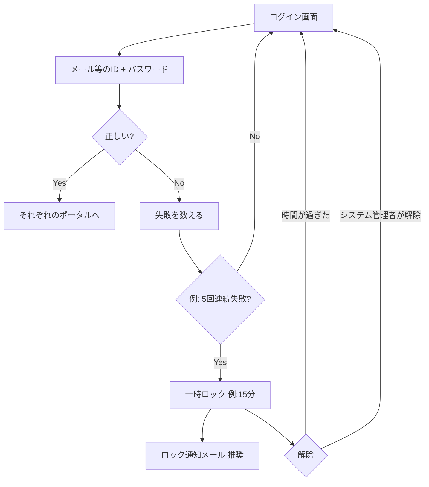

| 項目 | 内容 |
|------|------|
| 対象 | 病院ユーザーもカマタニも同じ仕組み |
| パスワード | **ハッシュ化して保存**（そのまま保存しない） |
| ロック | 連続失敗（例: 5回）→ 例: 15分入れない |
| 解除 | ①自動 ②システム管理者の画面 |

## 4.2 パスワードを忘れたとき

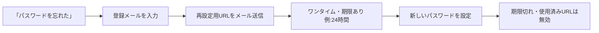

---

# 5. アカウントをどう作るか

## 5.1 種類

| 種類 | 例 | どこに保存（概念） |
|------|-----|-------------------|
| カマタニ管理者 | システム／運営／営業／経理 | `admin_users` |
| 病院・院全体管理者 | 病院の総管理者 | 顧客ユーザー |
| 病院・部署管理者 | 外科だけの管理者 | 顧客ユーザー |

## 5.2 仕様で分かっていること / 分かっていないこと

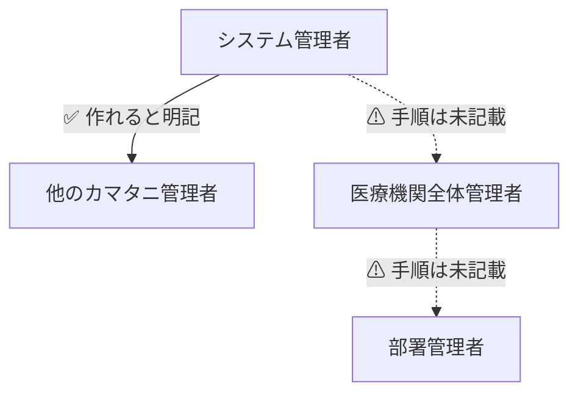

| アカウント | ✅ 仕様 | ⚠ 未記載 | 💡 よくある運用（要合意） |
|------------|---------|----------|---------------------------|
| カマタニ管理者 | システム管理者が管理 | 初回パスワードの渡し方 | 画面で氏名・メール・ロール・PWを登録 |
| 院全体管理者 | 権限はある | **だれが初回発行するか** | 医療機関登録と同時にカマタニが発行 |
| 部署管理者 | 権限はある | **だれが発行するか** | 院全体管理者、またはカマタニ |

### カマタニ管理者を作るときに必要な項目（💡）

- 氏名  
- メール（ログインID）  
- パスワード  
- ロール（システム／運営／営業／経理）  

---

# 6. マスタをどう用意するか

「マスタ」＝ 繰り返し使う基本データです。

## 6.1 用意する順番（推奨）

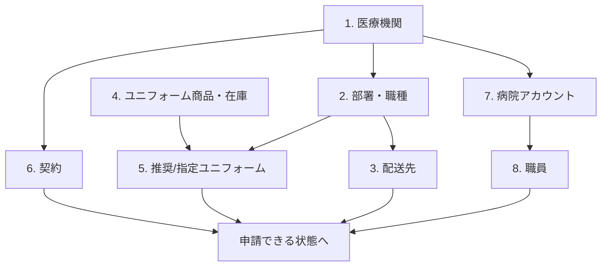

## 6.2 各マスタの説明

### ① 医療機関マスタ（カマタニ）

- 病院・診療所などのお客様  
- 通知メールの宛先をここで設定・変更できる ✅  

### ② 部署・職種マスタ（カマタニが主）

- 病院ごとに部署・職種を定義 ✅  
- **貸与するユニフォームと結びつける** ✅  
- 院全体管理者は「職種の管理・割当」ができる ✅  

### ③ 配送先マスタ

- 例: 「2階事務所」「3階ナースステーション」  
- カマタニも管理できる ✅  
- 院全体管理者は、一覧に無いとき **追加登録**できる ✅  
- 申請で必ず選ぶ ✅  

### ④ 職員（病院が主に登録）

→ [第9章](#9-職員の登録兼職)

---

# 7. 契約とは何か・どう作るか・どう効くか

ここが一番わかりにくいので、丁寧に書きます。

## 7.1 契約を初心者向けに言うと

**「この病院とは、どんなルールでユニフォームを貸し、どうお金を計算するか」の約束データ**です。

契約があると、システムは次ができます。

1. 病院が「今の契約・上限」を見られる  
2. 申請のとき「借りすぎ」をチェックできる  
3. 経理が「定額」か「ポイント」かで請求データを作れる  

## 7.2 契約に書いてあるべき中身

### ✅ 仕様から分かるもの

| 中身 | なぜ必要か |
|------|------------|
| どの医療機関か | 病院ごとの約束だから |
| 1人あたりの貸与上限 | 申請の数量チェック |
| 請求の種類: **定額（人数）** or **ポイント（従量）** | 請求の計算方法 |
| （定額）在籍人数 or 貸与人数 | 人数の数え方 ※両方書いてあるので要確認 |
| （ポイント）貸与点数 or クリーニング回数 | ポイントの数え方 ※要確認 |
| 契約の状況 | 病院・営業が「見る」ため |

### 🔷 動かすために必要（仕様の文章には項目名が無いが論理的に必要）

| データ | 理由 |
|--------|------|
| 適用開始日（と終了日） | 「いつから有効な契約か」・請求の対象期間 |
| 単価（人数単価 or ポイント単価） | 金額を出すため |
| 状態（有効／終了など） | 「契約状況」の表示 |

### 💡 あると便利

- 契約番号（社内・基幹との突合）  
- 備考  

## 7.3 だれが契約を作るか

| ロール | 仕様 |
|--------|------|
| 病院 | **見るだけ**（作れない） |
| 営業 | **見る**（作ると書いていない） |
| システム管理者 | **全機能** → 作れる |
| 経理 | 請求は作る。契約登録は未記載 |

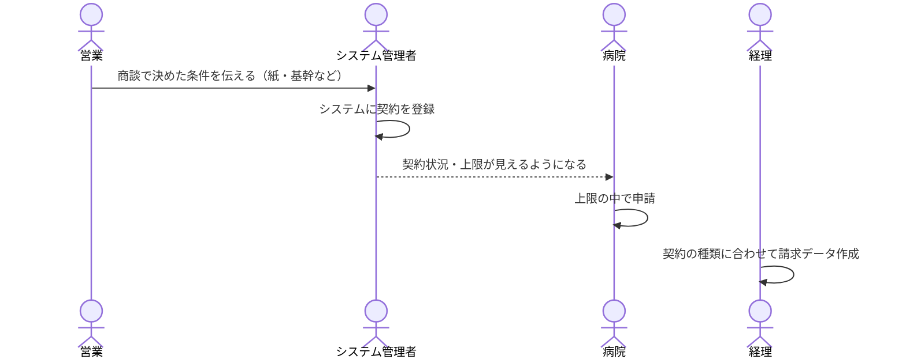

## 7.4 契約の作り方（手順）

### 事前条件

1. 医療機関マスタがある  
2. （すぐ申請するなら）部署・職種・商品・推奨/指定もあるとよい  
3. 請求モデル（定額かポイントか）と単価・上限が決まっている  

### 登録画面イメージ

```
┌─────────────────────────────────────────────────────────┐
│ 契約を登録する（カマタニ）                                │
├─────────────────────────────────────────────────────────┤
│ 病院*           [○○病院 ▼]                              │
│ 請求の種類*     (○) 定額・人数   ( ) ポイント・従量      │
│ いつから*       [2026-04-01]                            │
│ いつまで        [空欄=ずっと]                            │
│ 1人あたり上限*  [ 5 ] 着/点                             │
│ 単価*           ¥[ 2350 ]  ※種類に合わせて /人 or /pt   │
│ 契約番号        [任意]                                  │
│                              [やめる]  [登録する]       │
└─────────────────────────────────────────────────────────┘
```

### 登録した直後に起きること

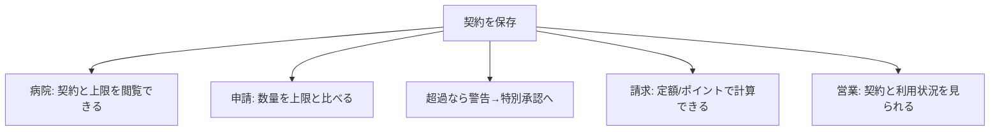

| 場面 | 契約が **ない** とき | 契約が **ある** とき |
|------|----------------------|----------------------|
| 申請 | 上限チェックができない → 止めるか全件特別承認かは設計で決める⚠ | 通常チェックできる |
| 請求 | 計算方法が分からない → 作れない | 作れる |
| 病院の契約画面 | 何も出ない | 状況・上限が出る |

## 7.5 契約と「推奨ユニフォーム」のちがい（超重要）

| 質問 | 答えるデータ |
|------|----------------|
| **いくら請求する？** | **契約**（定額／ポイント） |
| **何着まで借りてよい？** | **契約**（1人あたり上限など） |
| **どの商品を選べる？** | **推奨／指定ユニフォーム**（部署・職種） |

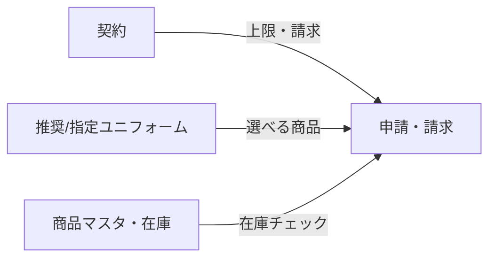

> 基幹システムの「契約プランマスター」Excel（商品コードが横に並ぶ表）は、  
> **この仕様書の中には出てこない**。  
> 仕様どおりなら「商品の許可」は推奨/指定、「上限とお金」は契約、と覚える。

## 7.6 契約の変更・終了

仕様に手順は無い。💡提案:

- 単価や上限を変えるときは **いつから有効か** を残す（過去の請求再現のため）  
- 終了日を過ぎたら新規申請は止め、過去の請求再現用データは残す  

---

# 8. 商品と「推奨・指定ユニフォーム」

## 8.1 商品マスタ（カマタニ）

- 商品の情報  
- サイズの範囲  
- 在庫数  

在庫を超える申請は **警告** の対象 ✅

## 8.2 推奨／指定ユニフォーム（カマタニ）✅

**部署 × 職種** ごとに、「この人たちが借りてよい（推奨・指定の）服」を写真付きで設定する。

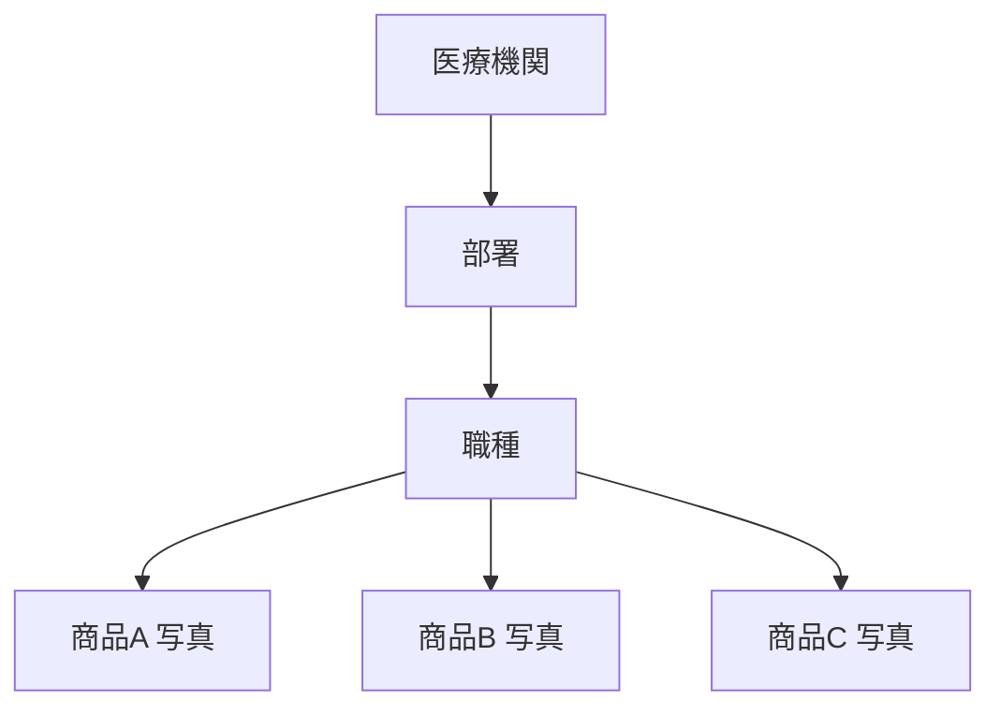

申請画面では:

> 職員の **部署** と **職種** を選ぶと、条件に合うユニフォームが **写真付きで自動表示** される ✅

### 画面イメージ

```
┌──────────────────────────────────────────────┐
│ 推奨/指定ユニフォーム設定                     │
│ 病院 → 部署 → 職種                           │
│ ☑ 指定(必須に近い) / ☐ 推奨                 │
│ 商品を追加（画像あり）                        │
└──────────────────────────────────────────────┘
```

⚠ 「指定」が申請で絶対必須か、おすすめ表示だけかは仕様が弱い → 要確認

---

# 9. 職員の登録・兼職

## 9.1 できること ✅

- 一覧・検索（氏名に加え **職員番号** で探す＝同姓同名対策）  
- 追加・編集  
- 在職 / 休職 / 退職  
- 上着・ズボン・靴のサイズ、性別  
- 職種  
- **兼職**: 1人が複数の部署・職種を持てる  
- 役割ごとに貸与条件セットを管理できる **設計にする**  

## 9.2 だれが操作するか

| | 院全体管理者 | 部署管理者 |
|--|:------------:|:----------:|
| 全部署 | ✅ | ❌ |
| 自部署 | ✅ | ✅ |
| CSV（全体） | ✅ | ❌（仕様の一文） |

## 9.3 流れ

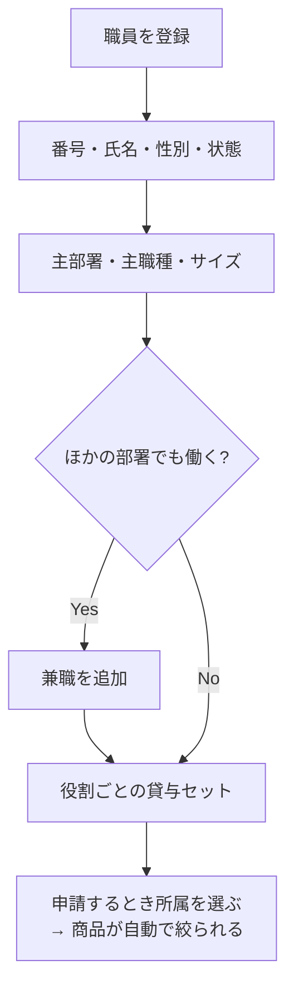

---

# 10. ユニフォーム申請（病院）

## 10.1 申請の種類 ✅

| 種類 | 意味 |
|------|------|
| 新規貸与 | 新しく借りる |
| サイズ変更 | サイズを変える |
| 返却 | 返す |
| 交換 | 返して新しく借りる |
| 移管（部分変更） | 例: 上着だけ変え、ズボンはそのまま |
| **クリーニング** | **申請しない**（決まった場所・時間に取りに来る） |

## 10.2 申請に必ず入れる情報 ✅

1. 申請の種類  
2. どの職員か  
3. どのユニフォームか（種類・サイズ）  
4. 何着か（契約の1人あたり上限を意識）  
5. **開始日** または **復職日**（※希望の届日は入れない）  
6. 配送先  

単位: **1人ずつ** または **部署まとめて**  
サイズの最初の値: 職員マスタに登録してあるサイズ  

## 10.3 申請の最初から承認待ちまでの流れ

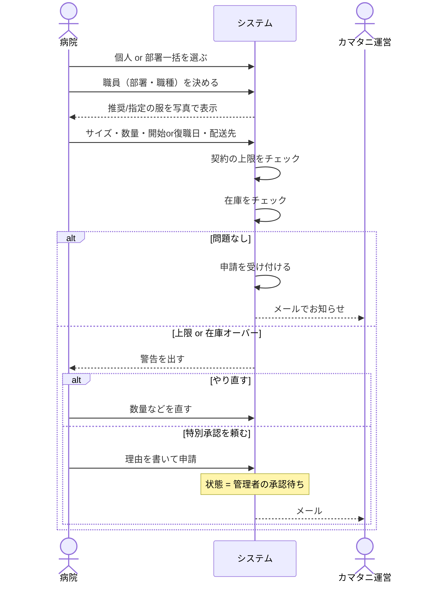

## 10.4 上限・在庫オーバーのときの2択 ✅

```
警告
  ├─ 「入力をやり直す」
  └─ 「特別承認を申請する」（理由を書く）
        → カマタニがOKしたら注文確定
```

## 10.5 キャンセル ✅

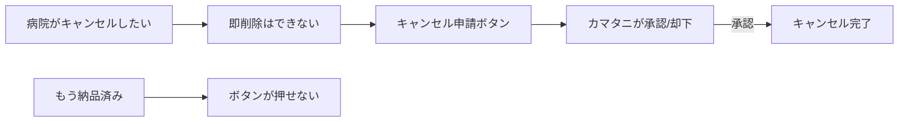

---

# 11. 承認・在庫（カマタニ）

## 11.1 運営担当がやること ✅

- 申請一覧・詳細で状態を管理  
- **特別承認**の承認／却下（上限オーバーなどの例外）  
- **キャンセル申請**の承認／却下  
- 発注・在庫の調整  

## 11.2 承認後に起きること（仕様の意図）

- 特別承認も含め、**承認されてから注文が確定**する  
- 在庫・貸与の状態が業務に合わせて更新される（運営が在庫調整）  

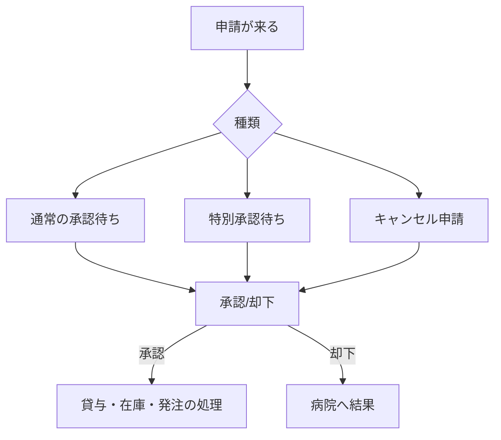

---

# 12. 請求データ（お金の計算。支払いではない）

## 12.1 初心者向けの注意

ここで作るのは **「いくら請求する根拠のデータ」** です。  
カード決済や入金チェックは **このシステムの仕事ではありません**。

## 12.2 必須① 過去の状態を再現する ✅

例: **「7月1日時点」** で

- その日、職員は在籍していたか  
- その日、何を借りていたか  

を再現して出す。**請求の土台として必須。**

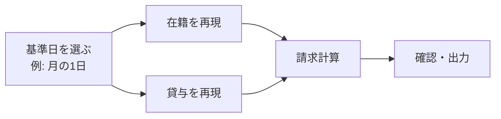

## 12.3 必須② 契約タイプで計算を変える ✅

| タイプ | ざっくり計算 |
|--------|----------------|
| 定額（人数） | （在籍人数 or 貸与人数）× 単価 |
| ポイント（従量） | （貸与の点数 or クリーニング回数）× 単価 |

⚠ 仕様は「または」と両方書いている → **どちらで数えるか顧客確認が必要**

## 12.4 だれが作るか ✅

- 経理（生成・確認・過去データの出力）  
- システム管理者（全機能）  

## 12.5 請求の流れ（最初から最後）

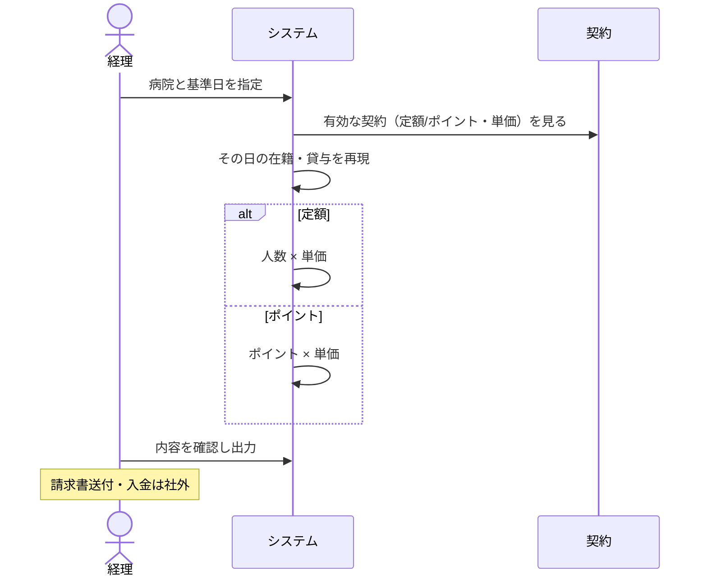

---

# 13. メール通知

## 13.1 いつ送るか ✅

病院が次をしたとき、**登録と同時に**カマタニ管理者へメール:

- 新規 / 変更 / 返却 / 交換 / 移管の申請  
- 特別承認の申請  
- キャンセル申請  

## 13.2 宛先 ✅

- 管理者マスタ  
- 医療機関マスタ  

で設定・変更できる。

## 13.3 その他 ✅

- ログイン連続失敗でロックしたとき、ロック通知メールを **送ることを推奨**

---

# 14. 画面イメージ（ワイヤー）まとめ

## 14.1 ログイン

```
┌────────────────────────────┐
│ ログイン                    │
│ メール [____________]      │
│ パスワード [________]      │
│ [ログイン]                 │
│ パスワードを忘れた方はこちら │
└────────────────────────────┘
```

## 14.2 病院 — 申請

```
┌──────────────────────────────────────────────────────────┐
│ ユニフォーム申請                                          │
│ 単位: (○)個人 ( )部署まとめ                              │
│ 種類: [新規貸与 ▼]                                       │
│ 職員* / 部署・職種                                       │
│ 開始日 or 復職日* [________]  ← 希望納品日は無い         │
│ 配送先* [______________ ▼]                               │
│                                                          │
│ ■ 借りられる服（自動で絞込み・写真）                     │
│  ┌────┐ 名称  サイズ[初期値▼] 数量[ ] 在庫:12           │
│  │写真│                                                  │
│  └────┘                                                  │
│ ⚠ オーバー: [やり直す] [特別承認（理由）]                │
│                                  [申請する]              │
└──────────────────────────────────────────────────────────┘
```

## 14.3 カマタニ — 承認

```
┌──────────────────────────────────────────────────────────┐
│ 申請の詳細                                                │
│ 状態: 特別承認待ち / 通常 / キャンセル申請               │
│ 病院・職員・明細・理由・上限・在庫                       │
│                 [却下]            [承認]                 │
└──────────────────────────────────────────────────────────┘
```

## 14.4 カマタニ — 契約

```
┌──────────────────────────────────────────────────────────┐
│ 契約登録                                                  │
│ 病院* / 定額orポイント* / 期間* / 1人上限* / 単価*       │
│                               [登録]                     │
└──────────────────────────────────────────────────────────┘
```

## 14.5 カマタニ — 請求

```
┌──────────────────────────────────────────────────────────┐
│ 請求データ作成                                            │
│ 病院*  基準日*（例: 月初）                               │
│ 契約の種類・単価（自動表示）                             │
│ [過去の状態を再現してプレビュー]                         │
│ 人数 or ポイント / 金額                                  │
│ [生成] [過去データ出力]                                  │
└──────────────────────────────────────────────────────────┘
```

## 14.6 メニューの見え方（誰がどこを使うか）

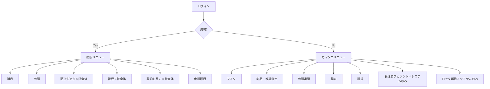

---

# 15. 要件チェックリスト（全部）

実装やテストのときに「仕様を満たしているか」を見る表です。

## 15.1 ユーザー・認証

| ID | 要件 | 優先 |
|----|------|------|
| R-AUTH-01 | 病院・カマタニとも ID/メール＋パスワードでログイン | 必須 |
| R-AUTH-02 | パスワードはハッシュ保存 | 必須 |
| R-AUTH-03 | パスワード再発行（メール・ワンタイム・期限例24h・使用後無効） | 必須 |
| R-AUTH-04 | 連続失敗で一時ロック（例5回・15分） | 必須 |
| R-AUTH-05 | ロック時メール通知（推奨） | 推奨 |
| R-AUTH-06 | ロック解除: 自動 or システム管理者手動 | 必須 |
| R-ROLE-01 | 院全体管理者の権限（§2.1(1)） | 必須 |
| R-ROLE-02 | 部署管理者は自部署のみ（§2.1(2)） | 必須 |
| R-ROLE-03 | カマタニ4ロール（システム／運営／営業／経理） | 必須 |
| R-ROLE-04 | システム管理者のみ他管理者アカウント管理・ロック解除 | 必須 |

## 15.2 マスタ・商品

| ID | 要件 | 優先 |
|----|------|------|
| R-MST-01 | 医療機関マスタ管理 | 必須 |
| R-MST-02 | 部署・職種マスタ（病院ごと・貸与と紐づけ） | 必須 |
| R-MST-03 | 配送先マスタ | 必須 |
| R-MST-04 | 院全体管理者が配送先を追加できる | 必須 |
| R-MST-05 | 職員の閲覧・検索（職員番号）・CSV | 必須 |
| R-PRD-01 | 商品・サイズ・在庫管理 | 必須 |
| R-PRD-02 | 部署・職種別の推奨／指定ユニフォーム（写真） | 必須 |

## 15.3 契約・申請・承認

| ID | 要件 | 優先 |
|----|------|------|
| R-CTR-01 | 契約状況・上限を病院が閲覧できる | 必須 |
| R-CTR-02 | 営業が契約・利用状況を閲覧できる | 必須 |
| R-CTR-03 | 申請数量が契約の1人あたり上限に基づく | 必須 |
| R-CTR-04 | 請求が定額 or ポイントに対応 | 必須 |
| R-APP-01 | 種別: 新規／サイズ変更／返却／交換／移管 | 必須 |
| R-APP-02 | クリーニングは申請不要 | 必須 |
| R-APP-03 | 必須項目: 種別・職員・商品・数量・開始or復職日・配送先 | 必須 |
| R-APP-04 | 個人／部署一括 | 必須 |
| R-APP-05 | 部署・職種で商品を写真付き自動表示 | 必須 |
| R-APP-06 | サイズ初期値は職員マスタ | 必須 |
| R-APP-07 | 希望納品日は病院が指定できない | 必須 |
| R-APP-08 | 上限／在庫超過で警告→再入力 or 特別承認 | 必須 |
| R-APP-09 | 特別承認は承認待ち→カマタニ承認で確定 | 必須 |
| R-APP-10 | 即削除不可。キャンセル申請→カマタニ承認 | 必須 |
| R-APP-11 | 納品後はキャンセル不可 | 必須 |
| R-APV-01 | 運営が承認／却下（特別・キャンセル含む） | 必須 |
| R-APV-02 | 運営が発注・在庫調整 | 必須 |

## 15.4 職員

| ID | 要件 | 優先 |
|----|------|------|
| R-EMP-01 | 一覧・氏名／職員番号検索 | 必須 |
| R-EMP-02 | 在職／休職／退職 | 必須 |
| R-EMP-03 | サイズ・性別 | 必須 |
| R-EMP-04 | 職種 | 必須 |
| R-EMP-05 | 兼職（複数部署・職種）と役割別貸与条件の設計 | 必須 |
| R-EMP-06 | CSV（院全体管理者。部署管理者の範囲は確認） | 必須 |

## 15.5 請求・通知

| ID | 要件 | 優先 |
|----|------|------|
| R-BIL-01 | 過去日時点の在籍・貸与を再現して出力 | 必須 |
| R-BIL-02 | 定額（人数）請求 | 必須 |
| R-BIL-03 | ポイント（従量）請求 | 必須 |
| R-BIL-04 | 経理が生成・確認・過去出力 | 必須 |
| R-BIL-05 | オンライン決済は対象外 | （範囲外） |
| R-MAL-01 | 申請・特別承認・キャンセルで管理者へメール | 必須 |
| R-MAL-02 | 宛先を管理者マスタ・医療機関マスタで変更可 | 必須 |

---

# 16. 仕様に無いこと・あとで決めること

## 16.1 仕様に書いていない（混同しない）

| よくある思い込み | 実際 |
|------------------|------|
| このシステムで支払いまで完結 | ❌ 請求データまで |
| 病院が届いてほしい日を指定 | ❌ 開始日／復職日のみ |
| クリーニングも申請する | ❌ 申請不要 |
| 申請を自分で消せる | ❌ キャンセル申請 |
| 営業が契約を登録する | ❌ 仕様は閲覧のみ |
| 契約プランExcelがこの仕様の中心 | ❌ 本仕様書に章なし |

## 16.2 実装前に顧客へ確認するリスト

1. 契約を登録・変更できるロールはだれか  
2. 定額の「人数」は在籍か貸与か  
3. ポイントは貸与点数かクリーニングか、両方か  
4. 契約が無い病院は申請できるか  
5. 院全体管理者・部署管理者の **初回アカウント発行者**  
6. 「指定」ユニフォームは申請必須か  
7. 兼職のとき上限や商品セットをどう合算するか  
8. 基幹の契約プランマスターを、本仕様のどこに載せるか  

---

## 付録. いちばん短い覚え方

```text
① カマタニが病院・マスタ・商品・推奨を用意する
② カマタニが契約（上限と請求ルール）を入れる
③ 病院が職員を入れ、服を申請する
④ オーバーなら特別承認、普通なら通常承認
⑤ 運営が承認し、在庫・貸与が進む
⑥ 経理が「過去のその日」を再現して請求データを作る
⑦ お金の受け渡しはシステムの外
```

---

*Document type: Requirements + End-to-end flows (beginner friendly)*  
*Source of truth: ユニフォーム管理システム 仕様書 (1) (1).docx*
